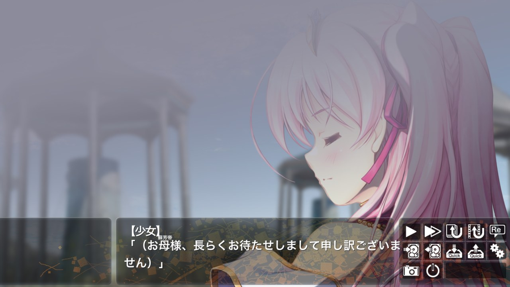

# ethornell-rs

`ethornell-rs` is a reimplementation of the Ethornell / BURIKO General Interpreter (a.k.a. "BGI") visual novel engine.

<table>
  <tr>
    <td width="50%" align="center">
      <br>
      <b>Desktop</b><br>
      <sub>千の刃濤、桃花染の皇姫 体験版 (BGI 1.622), title screen.</sub>
    </td>
    <td width="50%" align="center">
      <br>
      <b>Desktop</b><br>
      <sub>Character sprites, face window and message window.</sub>
    </td>
  </tr>
  <tr>
    <td width="50%" align="center">
      <br>
      <b>Web</b><br>
      <sub>The same game in Chrome (WebAssembly, WebGL2).</sub>
    </td>
    <td width="50%"></td>
  </tr>
</table>

The runtime detects the native game identifier from the comparison in
`system.arc:ipl._bp`. If detection is unavailable, the identifier falls back to
`Tayutama2TV`. For example:

```sh
cargo run -p ethornell-cli -- run --game /path/to/sun_flower
```

`--game` locates the resource archives, loose files, and user data.

Without arguments (a double-click), `ethornell` asks for the game folder;
`ethornell /path/to/sun_flower` plays it directly.

Builds for Windows (x86_64), Linux (x86_64 and AArch64), FreeBSD (x86_64),
macOS (a universal `Ethornell.app`), Android (APK), iOS (unsigned IPA), the
web (a static page), Nintendo Switch (NRO) and PS Vita (VPK) are published on
[GitHub Releases](https://github.com/xmoezzz/ethornell-rs/releases).
The `pre-release` entry follows `main`; `v*` tags publish versioned releases.
See [`platform/`](platform/README.md) for building and using each platform,
including the Android and iOS apps and the console ports.

The window uses the game's icon from `icon.png`, an `.ico` file, or the icon
resources embedded in its Windows executable, in that order.

On PC (desktop and headless), display text defaults to **Auto**: at startup
the engine samples BCS scenario strings once to choose Shift-JIS (`cp932`) or
GBK (`cp936`). It does not detect each line. Short or inconclusive samples fall
back to Shift-JIS. Override with
`--text-encoding gbk` (or `cp932` / `auto`), for example:

```sh
ethornell run --game /path/to/game --text-encoding auto
```

`ETHORNELL_TEXT_ENCODING=auto|cp932|gbk` is also supported on desktop/headless;
the command-line choice takes priority. This selects graphics text buffers,
including dialogue and speaker names. Resource names and BP system strings
keep their existing Shift-JIS encoding. Auto selects one display code page for
the session; it does not select a different encoding for each file.

Auto detection is compiled only for PC builds. iOS, Android, Web, Vita and
Switch retain their existing explicit/fixed encoding configuration and do not
scan scenario resources for encoding detection.


## Shinki embedded adaptation

The [`shinki-latest`](https://github.com/Project-Shinkirou/ethornell-rs/tree/shinki-latest)
branch merges xmoezzz/ethornell-rs `main` at `b5de417e4cff681bd2afb929e22e903d64602456`.
`crates/shinki-emu-ethornell-rs` (package
`shinki-emu-ethornell-rs`, library `shinki_emu_ethornell_rs`, plugin id
`ethornell-rs`) is a thin ABI adapter around the
original BGI VM, native media/audio/save implementation and GPU compositor.
The standalone and embedded frontends share graph, text, ruby and modeless-UI
composition. Embedded rendering reads the final offscreen GPU target; it does
not create a window or present.

The ABI exports `shinki_emu_query`; static registration uses `QUERY`.
The descriptor and probe share the format identifier `bgi-bp-arc`. This is a
machine-readable ABI symbol, not a display label with spaces or slashes.
`diagnostic-bridge` is for dynamically loaded modules. Static builds reuse the
host tracing subscriber. Startup-only configuration fields are `trace` and
`fail_on_stub` (advanced) plus the display localization fields; no text/resource
hooks, live configuration or render-extent control are advertised, and open
rejects any nonzero requested render extent.
Logical size L is the script's native screen size. Raster R equals L. Output O
is the host's actual client size and does not resize R. Pointer coordinates
already refer to the displayed raster; the adapter applies no second host
scaling. Primary/secondary/middle ABI buttons 1/2/3 map to native 1/2/4.
Keyboard semantics retain the original arrow/Enter/Space mapping and native
edit-text handling. Wheel values retain fractional line detents.

Each session owns a native worker, scheduler, GPU device and audio backend.
Pause/suspend freezes engine time and playing audio channels; focus loss
clears held input. Cancellation invalidates host window requests before join.
CPU frame leases own immutable pixels independently of session shutdown.
Close/reopen does not recreate an OS event loop. Native file/folder chooser
requests and desktop-wallpaper changes currently fail explicitly in embedded
mode because the host has no cancellable service for them; message, text and
bounded item dialogs use the typed host modal service.
Host failures retain the requested operation, flags and coordinates together
with the Host error code and message; failed window operations are not acknowledged.
Only native void cursor motion retains the fixed upstream
`6550460beb2012781cdaffdf18da59780de422ef` frontend policy
(`crates/ethornell-app/src/window.rs:389-397`): an execution failure is warned
and gameplay continues, without acknowledging a successful warp or updating
actual Host cursor state. Cancellation, stale context, malformed protocol and
other window/modal operations remain errors.

Dependencies are exact git revisions: `shinki-emu-abi` and the host-side
`shinki-emu-build` helper from
`Project-Shinkirou/ShinkiEMU@cb8d9dd22d7d0ab129085b324c94d6dc81fa19e3`
(C ABI 3), and Kira 0.8.7
from `Project-Shinkirou/kira@da8668fcd5e543eec2e9ea9871b310276e09fdc5`. The Kira fix
is separate from the adapter, based on upstream
`f46857e121872416fba0d539ff3d59aa99876fb8`, retaining its MIT/Apache-2.0 files.
It joins the desktop device watcher and adds an explicit gameplay-thread
decoder owner. Native audio shutdown drops the manager/device first, then
cancels and joins all registered movie-audio decoders. No joins run in the
realtime callback and dropping a playback handle still leaves playback alone.
The root patches CPAL 0.15.3 to
`Project-Shinkirou/cpal@65ac8a6ac1a635cc26bfc5af331295b052044908` (upstream
`ac6cbb2ba55e61665a35ab88ae136a83380d1354`, original Apache-2.0 license).
Its WASAPI stream destructor also joins when the Terminate channel is already
disconnected. Integrating workspaces must repeat this root-level patch because
Cargo ignores dependency-local patches.

Build from the fork checkout with Rust 1.92 or newer and MSVC build tools:

```sh
cargo build --manifest-path Cargo.toml --locked --release --target x86_64-pc-windows-msvc -p shinki-emu-ethornell-rs --features diagnostic-bridge
```

`build.rs` writes target/profile, `LICENSE-MPL-2.0` and `MODIFICATIONS.md` into
`OUT_DIR/core-build.json`. No core Resources are required; archives and optional
font overrides come from the user's game tree. The embedded adapter currently
supports Windows x64 MSVC.

For manual acceptance, load `target/x86_64-pc-windows-msvc/release/shinki_emu_ethornell_rs.dll`
in the integrated Shinki Manager using an authorized game copy and isolated user
files. Exercise title/menu, dialogue, native save/load, pause/resume and
close/reopen through the real Manager window. Run acceptance manually, without
automated input or screenshot drivers.

Upstream's root `[workspace.package]` declares `MPL-2.0`; the pinned tree
contains no license text, and its crate manifests do not inherit that
declaration. This adaptation adds the canonical Mozilla Public License 2.0 text
as `LICENSE-MPL-2.0` to accompany the declared license in source and binary
distributions. It preserves existing declarations without relicensing and does
not grant new rights.
